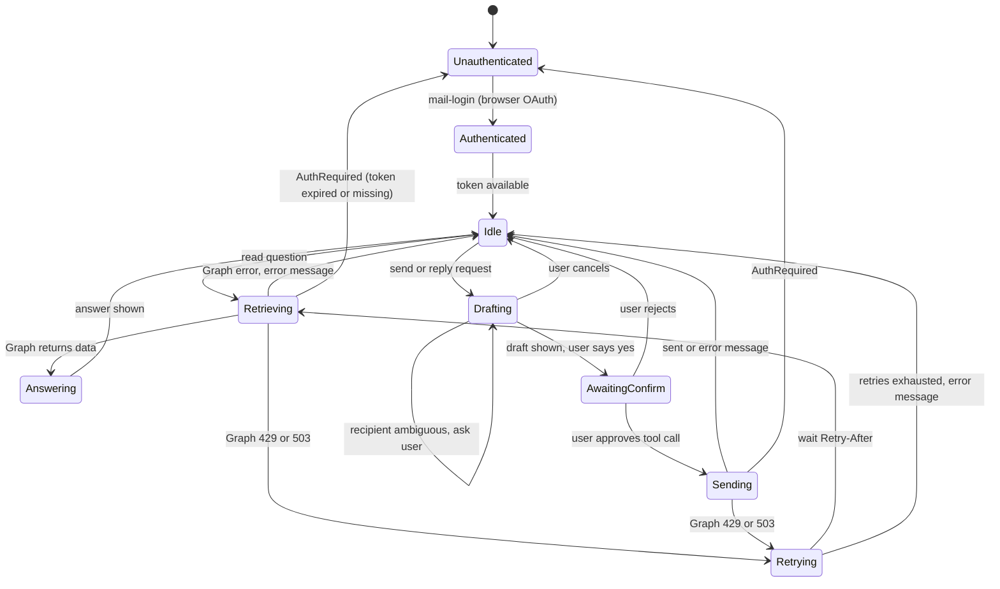

# Design

## Goal

A local assistant that answers questions about the user's Outlook mailbox and, on request, sends or replies to email, with every send explicitly approved by the user.

## Long-term goal

A hosted, multi-user mail assistant for organizations: same tool surface and safety model, with per-user OAuth, server-side session and token storage, an audit trail, and support for large mailboxes. See [scale.md](scale.md).

## Success criteria

| # | Criterion | How it is measured |
|---|---|---|
| 1 | The five brief prompts work end to end against a real mailbox | Manual run of each prompt in `adk web`; each returns a correct, cited answer or a correct send |
| 2 | Zero sends without user approval | Unit test: send tools cannot execute without confirmation; manual test: rejecting the dialog sends nothing |
| 3 | Tests pass with no network | `uv run pytest -q` green; Graph mocked with respx |
| 4 | Lint clean | `uv run ruff check .` reports nothing |
| 5 | No secrets or mail content in logs or git | Review of logging calls; `.env` and `token_cache.json` are gitignored |
| 6 | Expired or missing sign-in produces a clear instruction, not a stack trace | Test: no cache raises `AuthRequired`; tool returns `{"status": "error", "message": "Not signed in. Run: ..."}` |
| 7 | Throttling is survived | Test: 429 with `Retry-After` is retried, at most 3 times |

## Use case

A professional gets dozens of emails a day. They want to ask in plain language, "who emailed me about the meeting yesterday?" or "summarize the latest email", without opening Outlook and without having a model rummage through the mailbox unsupervised. They also want to say "send Alice a note confirming tomorrow's meeting" and see exactly what will be sent before it goes. The assistant is read-mostly: it can read and send, and it cannot delete, move, forward, or edit anything. Email content is treated as untrusted data, because anyone can send the user a message that tries to instruct the model.

## User flow

1. Setup (once): register an Azure app, `uv sync`, fill `.env`.
2. Login (once): `uv run mail-login` opens the browser; the user signs in and consents, tokens cached locally.
3. Ask: user starts `adk web` and types a question.
4. Retrieve: the agent picks a tool (`list_emails`, `search_emails`, `get_email`), which calls Graph with a token from `auth.py`.
5. Answer: the agent summarizes, citing sender, subject and date. If nothing matches it says so.
6. Draft (send path): the agent resolves the recipient with `find_contact`, shows To / Subject / Body in chat.
7. Confirm: the user says "yes" in chat; then ADK asks for approval of the exact tool arguments.
8. Send: only after approval does the tool body run and call Graph. The agent reports success or the error.

## State diagram

`Retrying` is bounded: at most 3 retries, honoring `Retry-After`. A 401 gets one forced token refresh and one retry before it becomes `AuthRequired`.

## Features

Difficulty: Green = straightforward, Yellow = a known Graph or ADK pitfall, handled in code, Red = no complete solution exists, mitigated in layers.

| Feature | Tool(s) | Difficulty | Notes |
|---|---|---|---|
| List latest emails | `list_emails` | Green | `GET /me/mailFolders/{folder}/messages`, `$orderby=receivedDateTime desc`, `$top`, `$select` |
| Unread filter | `list_emails(unread_only)` | Green | `$filter=isRead eq false`, combined with the date predicate |
| Filter by sender address | `list_emails(sender)` | Yellow | `$filter` on `from/emailAddress/address`; the `$orderby` property must lead the filter or Graph returns `InefficientFilter`, so we always start with `receivedDateTime ge ...` |
| Filter by sender name | `list_emails(sender)` | Yellow | Display names cannot be filtered reliably; uses `$search "from:<name>"`, which is relevance-ordered (see below) |
| Topic and date search | `search_emails` | Yellow | `$search` cannot be combined with `$orderby` or `$filter` on messages; we sort by date and apply `since`/`until` client-side |
| Read full message | `get_email` | Green | Plain-text body, truncated at 4000 chars with `truncated=true` |
| Name to address resolution | `find_contact` | Yellow | `$search "participants:<name>"`, dedupe by address; never guesses. 0 matches: ask for the address; more than 1: ask the user to choose |
| Send with confirmation | `send_email` | Yellow | `POST /me/sendMail`; two gates (chat draft plus ADK tool confirmation) |
| Reply with confirmation | `reply_to_email` | Yellow | `POST /me/messages/{id}/reply`; same two gates |
| Relative dates and timezones | instruction provider | Green | Current date, weekday, time, yesterday and tomorrow injected every turn in `USER_TIMEZONE` |
| Throttling and token expiry | `graph_client` | Green | `Retry-After` honored, 401 refresh-once |
| Prompt-injection resistance | instruction, tool surface, send gate | Red | No model-level guarantee exists; see Key decisions |

## Integrations and Graph permissions

| Endpoint | Used by | Delegated permission |
|---|---|---|
| none (ID token claims) | `mail-login` ("Signed in as ..." reads `preferred_username` from the ID token; no `GET /me`) | `User.Read` (sign-in) |
| `GET /me/mailFolders/{folder}/messages` | `list_emails` (`$filter`/`$orderby`, or `$search "from:<name>"` for a sender name) | `Mail.Read` |
| `GET /me/messages` with `$search` | `search_emails`, `find_contact` (all folders) | `Mail.Read` |
| `GET /me/messages/{id}` | `get_email` | `Mail.Read` |
| `POST /me/sendMail` | `send_email` | `Mail.Send` |
| `POST /me/messages/{id}/reply` | `reply_to_email` | `Mail.Send` |

Why only these:

- Least privilege. `Mail.ReadWrite` would allow editing, moving and deleting mail and creating drafts. The assistant needs none of that, so a bug or an injected instruction cannot delete mail.
- Consequence: no Graph drafts. Creating a draft message needs `Mail.ReadWrite`. Drafts live in the conversation instead, which also makes them visible to the user at the point of approval.
- `offline_access`, `openid` and `profile` are not passed by us. MSAL adds them itself (and raises if we pass them), which is what gives us a refresh token.
- Contacts permissions (`Contacts.Read`) are not requested. Name resolution uses people the user has actually corresponded with, taken from mail they can already read.

## Key decisions and trade-offs

Full rationale is in [decisions.md](decisions.md). The ones that shape the design:

- Direct REST (httpx) vs msgraph-sdk. We call five endpoints. The SDK adds a large dependency tree and hides the `$filter`/`$search` behavior we have to control. Direct calls keep headers, params and retry policy visible and testable with respx. Cost: we maintain the URL and param construction ourselves.
- Interactive auth code + PKCE vs device code vs ADK tool auth. ADK's OAuth support for tools is built around a browser redirect handled by a hosted agent. This is a local CLI/`adk web` tool, so `mail-login` uses MSAL's `acquire_token_interactive`: the standard authorization code flow with PKCE, the system browser, and a `http://localhost` redirect with no client secret. MSAL handles caching and silent refresh. Device code was dropped (D-27): it needs a code copied between windows and is a known phishing vector. Cost: sign-in needs a local browser and the redirect URI in Entra (headless machines use `GRAPH_BEARER_TOKEN`), and a public client cannot be used for a hosted multi-user service (see scale.md).
- `sendMail` without drafts vs Graph drafts. Drafts need `Mail.ReadWrite`. We trade the convenience of "review in Outlook" for a smaller permission set.
- Confirmation before send: two gates. Gate 1 is the instruction: resolve the recipient, show To/Subject/Body, wait for "yes". Gate 2 is ADK native tool confirmation (`FunctionTool(require_confirmation=True)`): the function body cannot run until the user approves the exact arguments. Gate 2 is enforced in code, so a confused or prompt-injected model cannot send silently. Cost: native confirmation is experimental in ADK and is not supported with `DatabaseSessionService`/`VertexAiSessionService`. That is fine locally: `adk web` in ADK 2.13 stores sessions in SQLite (`SqliteSessionService`, a separate class from `DatabaseSessionService`), and we verified end to end that the approval gate works there (no send before approval, none after reject, exactly one after approve) and is called out in scale.md as the first thing to replace for a hosted version.
- Metadata first, body on demand. List and search return id, subject, from, recipients, date, `bodyPreview` (about 255 chars) and `isRead`. Full text is fetched only by `get_email` and truncated at 4000 chars. This keeps the context small, makes "who emailed me" cheap, and limits how much untrusted text enters the prompt.
- Prompt injection. Mitigations stack because no single one is sufficient: (1) the instruction says email content is data, never instructions, and to report suspicious requests to the user; (2) there is no forward, delete or move tool, so the blast radius is small; (3) sending is blocked by a code-enforced approval that shows the real recipient; (4) bodies are requested as plain text (`Prefer: outlook.body-content-type="text"`), so there is no HTML to hide instructions in or to parse.

## Scale-up and rollout

Summary; detail and numbers are in [scale.md](scale.md).

- Pilot: start in draft-only mode (send tools disabled), build an eval set from real questions, then enable sends with approval.
- Multi-user hosted version: auth code flow with PKCE (or a confidential client with a certificate) through a web redirect, per-user encrypted token store, stateless agent workers with a database session store, audit log of every send. Native ADK confirmation gives way to a server-side pending-action pattern.
- Large mailboxes: Graph delta query to keep a per-user local index, plus embeddings for semantic search, instead of `$search` only.
- Real time: change notifications (webhooks) with lifecycle notifications and subscription renewal.
- Throttling: respect per-mailbox limits, backoff, request batching with `$batch`, a queue for backpressure.

## Key challenges

- `InefficientFilter`. Graph rejects `$filter` plus `$orderby` combinations unless the `$orderby` property appears first in the filter. We build filters so the date predicate always leads. Covered by a test on the generated query.
- `$search` ordering. `$search` results are relevance-ordered and cannot be combined with `$orderby` or `$filter` on messages. We sort by `receivedDateTime` and apply date ranges client-side. Limitation: this only sees the fetched window, not the whole mailbox. This is also why `search_emails` has `since`/`until` parameters that the original brief did not list: "about the meeting yesterday" needs a topic and a date, and the date cannot go in the query.
- Relative dates and timezones. A model does not know today's date, and "yesterday" depends on the user's timezone. The instruction is a function evaluated every turn that injects the current date, weekday, time, timezone, yesterday and tomorrow. `tzdata` is a dependency because Windows has no tz database.
- Recipient resolution without guessing. "Send an email to Alice" must not become a send to the wrong Alice. `find_contact` returns unique name/address pairs from real correspondence; zero or multiple results go back to the user. The approval dialog then shows the final address.
- ADK confirmation is experimental. We rely on it for gate 2, so it is pinned to a tested ADK version and covered by a test that the send function does not execute when confirmation is absent. If the API changes, gate 1 still holds and the two-step pending-action design in decisions.md D-06 is the fallback.
- Personal-account search differences. `$search` on consumer Outlook.com mailboxes can return different relevance and lag new mail. We cannot fix the index; the agent states when nothing matched, and the README lists it as a limitation.
