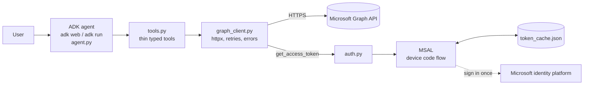

# Outlook Mail Agent

A local email assistant built with Google ADK (Python) and Microsoft Graph. It reads your Outlook mailbox, answers questions about it ("Who sent the latest email?", "Who emailed me about the meeting yesterday?"), and sends or replies to email only after you approve the exact message.

It runs on your machine (`adk web` or `adk run`). Sign-in uses the OAuth device code flow, so there is no redirect URI and no client secret. Tokens stay in a local, gitignored cache file.

For the reasoning behind the design see [DESIGN.md](DESIGN.md), [decisions.md](decisions.md) and [scale.md](scale.md).

## Architecture



- `agent.py` holds the instructions and registers the tools. It contains no HTTP code.
- `tools.py` validates input, calls the client, and returns small JSON-safe dicts. Errors come back as `{"status": "error", "message": ...}`; tools never raise into the agent.
- `graph_client.py` is the only module that talks to Graph.
- `auth.py` is the only module that touches MSAL and the token cache.

## Prerequisites

- Python 3.12
- [uv](https://docs.astral.sh/uv/)
- A Microsoft account (personal Outlook.com or work/school)
- A Gemini API key from https://aistudio.google.com/apikey

## Azure app registration

You need one app registration so Microsoft can identify this program during sign-in. It is free.

1. Go to https://entra.microsoft.com and open Identity > Applications > App registrations.
2. Click New registration.
3. Enter a name, for example `outlook-adk-agent`.
4. Under Supported account types choose "Accounts in any organizational directory and personal Microsoft accounts".
5. Leave Redirect URI empty. Click Register.
6. Copy the Application (client) ID from the Overview page. This is `MS_CLIENT_ID`.
7. Open Authentication, scroll to Advanced settings, set "Allow public client flows" to Yes, and Save. Device code flow fails without this.
8. Open API permissions > Add a permission > Microsoft Graph > Delegated permissions. Add `User.Read`, `Mail.Read` and `Mail.Send`.

No admin consent is needed for these three on personal accounts. On a work tenant, your admin may need to grant consent if user consent is disabled.

## Bearer token fallback (no Azure registration)

If you cannot register an app, use a temporary token from Graph Explorer:

1. Open https://developer.microsoft.com/graph/graph-explorer and sign in.
2. Consent to `Mail.Read` and `Mail.Send` (Modify permissions tab).
3. Open the Access token tab and copy the token.
4. Put it in `.env` as `GRAPH_BEARER_TOKEN=...`.

When this variable is set, MSAL is skipped entirely. The token lasts about one hour and is not refreshed; after it expires every tool returns an auth error until you paste a new one. Remove the variable to go back to MSAL.

## Setup

```bash
uv sync
cp .env.example .env     # on Windows PowerShell: Copy-Item .env.example .env
```

Edit `.env` in the repo root (ADK walks up from the agent folder to find it):

| Variable | Required | Meaning |
|---|---|---|
| `GOOGLE_API_KEY` | yes | Gemini API key |
| `GEMINI_MODEL` | no | Defaults to `gemini-flash-latest` |
| `MS_CLIENT_ID` | yes (unless bearer token) | Application (client) ID from the registration |
| `MS_TENANT` | no | Defaults to `common` |
| `USER_TIMEZONE` | no | IANA name used to resolve "yesterday", "tomorrow" (example: `Asia/Kolkata`) |
| `GRAPH_BEARER_TOKEN` | no | Short-lived token that bypasses MSAL |

`.env` and `token_cache.json` are gitignored. Never commit them.

## Sign in

```bash
uv run mail-login
```

You will see Microsoft's device code message (illustrative output):

```
To sign in, use a web browser to open the page https://microsoft.com/devicelogin
and enter the code ABCD1234 to authenticate.
Signed in as you@example.com
```

Open the URL, enter the code, sign in, and approve the three permissions. The token cache is saved to `token_cache.json`. After that, tokens refresh silently; you only repeat this if the refresh token expires or you log out.

```bash
uv run mail-logout    # deletes the cached account and tokens
```

If you ask the agent something before signing in, it replies with the login command instead of failing.

## Run

Run from the repo root.

```bash
uv run adk web                  # open http://localhost:8000 and pick "mail_agent"
uv run adk run mail_agent       # terminal chat
```

Sending is gated twice. The agent first shows you a To / Subject / Body draft in chat and waits for an explicit "yes". Then ADK pauses the send tool and asks for approval of the exact arguments (recipient address included): a confirmation dialog in `adk web`, a prompt in `adk run`. The email is only sent if you approve there. If you reject, nothing is sent.

## Example prompts

| Prompt | What happens |
|---|---|
| Who sent the latest email? | `list_emails(top=1)`, reports sender, subject, date |
| Show emails from Alice. | `list_emails(sender="Alice")`. An address becomes a `$filter`; a name becomes `$search "from:Alice"` |
| Summarize the latest email. | `list_emails(top=1)` then `get_email(id)` for the full text, then a summary |
| Who emailed me about the meeting yesterday? | `search_emails("meeting", since=<yesterday>, until=<today>)`; dates come from the instruction provider |
| Send an email to Alice confirming the meeting tomorrow. | `find_contact("Alice")`, draft shown in chat, you say "yes", `send_email` pauses for approval, then sends |
| Summarize my unread emails | `list_emails(unread_only=True)`, `get_email` for items that need more than the preview |
| Find emails about the invoice | `search_emails("invoice")` |
| Reply to the latest email from Alice saying I'll join | `list_emails(sender="Alice", top=1)`, draft shown, "yes", `reply_to_email` pauses for approval |

If nothing matches, the agent says so. If a name matches several people, it asks you to choose. If it finds no address, it asks you for one. It never guesses a recipient.

## Tests and lint

```bash
uv run pytest -q
uv run ruff check . && uv run ruff format .
```

Graph is mocked with `respx`; the suite makes no network calls.

## Project layout

```
mail_agent/
  __init__.py      # from . import agent   (ADK discovery)
  agent.py         # root_agent, instruction provider
  tools.py         # ADK tools (thin, typed, docstrings are prompts)
  graph_client.py  # all Graph HTTP calls, retries, errors
  auth.py          # MSAL login/logout, token cache, get_access_token()
  config.py        # env loading
  models.py        # TypedDicts for email data
tests/             # no __init__.py on purpose, so adk web lists only mail_agent
README.md  DESIGN.md  decisions.md  scale.md
.env.example  pyproject.toml
```

## Limitations and next steps

- Graph `$search` on personal Microsoft accounts can behave differently from work accounts and may lag behind new mail (index delay).
- `$search` results are relevance-ordered. We sort by date and apply date ranges client-side, only within the fetched window (max `top` results, Graph caps `$search` at 1000).
- No attachments (read or send). Bodies are plain text only.
- Sessions are in-memory, and the agent serves a single user.
- ADK's native tool confirmation is an experimental feature; its API may change between ADK releases.
- No drafts in Outlook: `Mail.ReadWrite` is deliberately not requested, so drafts exist only in the chat.

Next steps (multi-user hosting, large mailboxes, change notifications) are in [scale.md](scale.md). Trade-offs are in [DESIGN.md](DESIGN.md) and [decisions.md](decisions.md).
