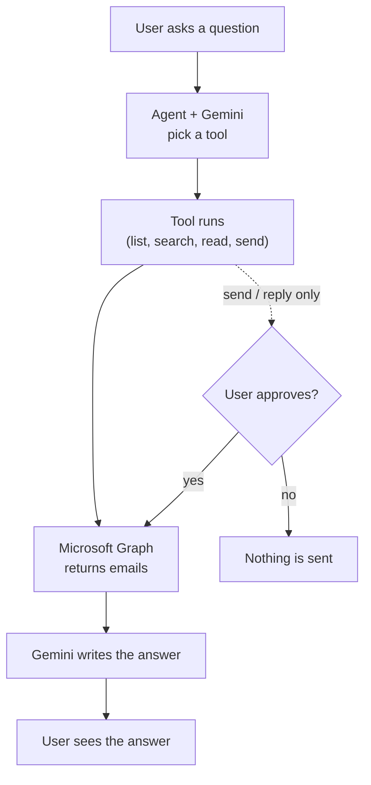
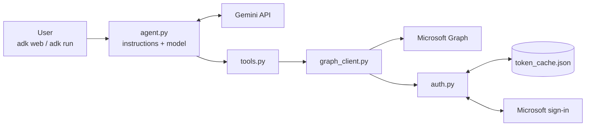

# Diagrams

## 1. Flow: from question to answer

Sending has two checks: the agent shows the draft and waits for "yes", then ADK asks you to approve the exact email before it goes out.

## 2. Components (current)

- `agent.py`: what the model is told, and which tools it may use.
- `tools.py`: the actions the model can take.
- `graph_client.py`: the only code that calls Microsoft Graph.
- `auth.py`: signs you in once (`mail-login`) and keeps the token fresh.
