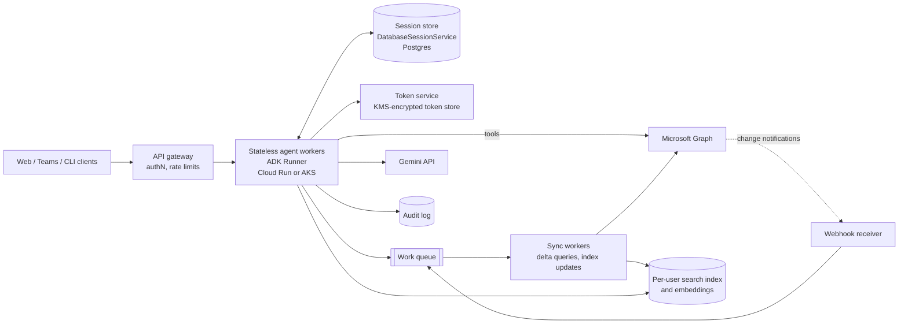

# Scaling to a large user base

This is a plan, not an implementation. Nothing here is built. Numbers are estimates unless attributed to Microsoft documentation, and Microsoft limits should be re-verified against current Graph docs before sizing.

## Target

| Phase | Users | Assumed activity | Peak load (estimate) |
|---|---|---|---|
| Pilot | 50 | 20 agent turns per user per day | under 1 turn/s |
| Team/org rollout | 10,000 | 10 turns per active user per day, 30% daily active | about 30,000 turns/day, about 3 turns/s at peak (10x average) |
| Large scale | 1,000,000 | same ratios | about 3,000,000 turns/day, about 350 turns/s at peak (10x average) |

A turn is one user message and the model/tool calls it triggers. Assume 1 to 3 Graph calls and 1 to 3 LLM calls per turn. At 1M users this means roughly 350 to 1,000 Graph calls/s at peak, spread across 1M separate mailboxes, which matters because Graph limits are per mailbox (see Throttling).

## Architecture

Principles:

- Workers are stateless. All conversation state is in the session store; all credentials are behind the token service. Any worker can serve any turn, so scaling is horizontal.
- Tools keep the same interface as the local version. Only `auth.py` (token source) and the confirmation mechanism change.
- Graph reads that can be served from the local index are, so interactive latency does not depend on Graph throughput.

## Auth at scale

The local device-code, public-client, file-cache setup does not carry over.

- Flow: authorization code with PKCE through a web redirect. The user signs in once in the browser; the service receives the code and exchanges it.
- Client type: confidential client authenticating with a certificate (not a secret) stored in a key vault, rotated on a schedule.
- Token storage: per-user refresh tokens in a database, encrypted with envelope encryption (a per-user data key wrapped by a KMS key). Access tokens are short-lived and cached in memory or Redis for under an hour. The token service is the only component with decrypt permission; agent workers request "an access token for user X" and never see refresh tokens.
- Tenants: for organizations, use admin consent for `User.Read`, `Mail.Read`, `Mail.Send` so users do not hit consent prompts. Respect Conditional Access: MFA or device-compliance failures surface as `interaction_required`, which maps to "re-authenticate" in the UI, not a retry loop.
- Revocation: handle user sign-out, password reset, and admin revocation (refresh token invalid). Mark the account `needs_login`, stop background sync for that user, and tell the user on the next turn. Provide an admin kill switch per tenant.
- Confirmation: ADK native tool confirmation is not supported with `DatabaseSessionService`, which hosted workers need. Replace it with the two-step pending-action pattern: `prepare_send` stores the exact message (recipient, subject, body) server-side and returns a preview plus an action id signed with an HMAC bound to user id, session id and an expiry (for example 10 minutes). A separate `confirm_send(action_id)` is exposed only through a UI button or an authenticated approval endpoint, not as a model-callable tool. The server sends exactly the stored message, so the model cannot alter it after approval.

## Graph throttling and cost

Graph throttles per app and per mailbox. As documented by Microsoft for Outlook at the time of writing (verify before relying on them): 10,000 requests per 10 minutes per app per mailbox and 4 concurrent requests per app per mailbox. Because the limit is per mailbox, a million users do not share one budget, but one user's bursty agent can throttle that user.

- Honor `Retry-After` on 429/503, with jittered exponential backoff when the header is absent. Already implemented locally (max 3 retries); at scale add a per-mailbox concurrency limit of 4 enforced by the worker, not discovered through 429s.
- Use `$batch` (up to 20 sub-requests per call) when a turn needs several reads, for example fetching 5 message bodies.
- Use delta query for sync instead of re-listing (see Large mailboxes).
- Cache: message metadata by `(user, id)` with a short TTL for repeated turns in a conversation; immutable bodies can be cached longer, encrypted, and deleted on retention expiry.
- Backpressure: agent workers put background work (sync, backfill) on a queue with per-user and per-tenant concurrency caps. Interactive turns get priority over sync. When a mailbox is throttled, the agent answers from the index and says it may be slightly stale.
- Cost control: the dominant cost is the LLM, not Graph (see LLM cost).

## Large mailboxes

`$search` is capped at 1000 results, is relevance-ordered, and cannot be combined with `$orderby`/`$filter`. For mailboxes with hundreds of thousands of messages that is not enough.

- Initial sync: page through messages once per user (background, rate-limited), storing metadata and a normalized plain-text body in a per-user index. Estimate 5-20 KB per message; a 100k-message mailbox is 0.5-2 GB before compression, so index only a retention window (for example last 12 months) by default.
- Incremental sync: Graph delta query per folder (`/messages/delta`) with stored delta tokens, run on change notifications and on a periodic safety schedule (for example every 15 minutes).
- Search: hybrid. Keyword (BM25) filters and sorts by date and sender exactly, which fixes the `InefficientFilter` and `$search` ordering problems. Embeddings (chunked bodies) serve topical questions such as "that thread about the vendor contract". Index per user, or per tenant with user-id filtering, never shared across tenants.
- Retention: index only what policy allows. Delete index entries when the source message is deleted (delta reports removals) and when the user disconnects.
- Fallback: if the index is missing or behind, fall back to the live Graph tools used today.

## Real-time

- Subscribe to change notifications on each user's mail (`/me/messages`, created and updated). Webhook receiver validates the validation token, checks `clientState`, and enqueues a delta sync; it does no work inline and answers in under 3 seconds.
- Mail subscriptions expire after at most about 3 days (4230 minutes, per Microsoft docs; verify). Run a renewal job that renews at roughly half of the lifetime, and handle lifecycle notifications (`reauthorizationRequired`, `subscriptionRemoved`, `missed`) by renewing or doing a full delta resync.
- Product use: push a "new mail needs attention" nudge, and keep the index fresh so answers match what the user sees in Outlook.
- At 1M users that is 1M subscriptions to renew every 1-2 days, roughly 8-12 renewals/s sustained; budget for it in the queue and spread renewals with jitter.

## LLM cost and latency

Estimates for sizing, to be replaced by measurements:

- A typical turn is 3k to 8k input tokens (instruction, tool results, history) and 200 to 600 output tokens, with 1 to 3 model calls.
- Model routing: a flash-class model for retrieval Q&A and summaries (the default); a stronger model only for drafting longer replies or when a classifier flags a complex request. Target at least 90% of turns on the cheaper model.
- Context budget: keep metadata-first retrieval, 4000-char body cap, and top N of 10 by default; summarize and drop old tool results from history after N turns.
- Caching: provider-side prompt caching for the stable part of the instruction. Note that the current instruction injects the date each turn, so at scale put the date in a trailing block so the prefix stays cacheable. Cache summaries of immutable emails by message id.
- Quotas: per-user daily turn and token budgets, per-tenant monthly budgets, and alerts at 80%. Degrade to a smaller context rather than failing.
- Latency target (estimate): p50 under 4 s and p95 under 10 s for read questions; sends are bounded by the human approval step.

## Safety

- Prompt injection: keep the policy that email is data. Add an injection classifier or a separate low-privilege summarizer for untrusted bodies, so the model with send authority never sees raw email text in the same context where it can send. Strip or flag invisible Unicode and very long base64-like blobs.
- Sends: every send requires approval of the exact stored message (pending-action pattern above). Add per-user send rate limits (for example 20/hour, 100/day) and a tenant kill switch.
- Outbound allow-lists: enterprises can restrict recipients to their own domains or an approved list; sends outside it are blocked or need a second approver.
- DLP: scan outgoing body and subject with the tenant's DLP rules before the approval step so the user sees a warning on the preview.
- Audit log: append-only record of every send and every approval or rejection: user, tenant, timestamp, recipient addresses, subject hash, action id, approver client info. Store no bodies by default. Retain per tenant policy (for example 1 year).
- Least privilege stays: still no `Mail.ReadWrite`, no delete or move. If drafts become a requirement, make it an opt-in tenant setting.

## Multi-tenancy and compliance

- Tenant isolation: tenant id on every row, in every cache key and index namespace; row-level security in Postgres; separate KMS keys per tenant for enterprise customers.
- Data residency: deploy regional stacks (for example EU, US) and pin each tenant to a region. The LLM endpoint must be in that region as well.
- GDPR and deletion: a per-user delete job removes tokens, sessions, index, embeddings and cached summaries, and produces a completion record. Export on request. Document the subprocessors (cloud provider, LLM provider).
- Logging: never log email bodies, subjects, tokens or the token cache; log ids, counts, status codes, and latencies. Enforce with a log scrubber and a CI check for forbidden patterns.
- Retention: sessions and conversation history expire (for example 30 days) unless the tenant opts in to longer.

## Observability

- OpenTelemetry tracing: one trace per turn, spans for each model call and each tool call (tool name, status, duration, Graph status code, retry count), no content in span attributes.
- Metrics: turns/s, tool error rate by type (`AuthRequired`, throttled, Graph 5xx), 429 rate per tenant, token usage and cost per turn, approval rate and rejection rate for sends, index lag (time since last delta).
- Dashboards and error budgets: for example 99.5% of read turns succeed and 99.9% of approved sends are delivered to Graph, measured monthly. Page on burn rate, not single errors.
- Eval dashboards: pass rate by category (see Evaluation) tracked per release and per model version.

## Evaluation

- Eval set: a few hundred real, consented, anonymized questions across the categories in DESIGN.md (latest email, sender, topic plus date, summarize, send/reply, ambiguous recipient, injection attempts). Each case has a fixture mailbox and an expected tool sequence and answer facts.
- Tooling: ADK's eval support for tool-trajectory and response checks, plus an LLM judge for summaries with a human spot-check of a sample.
- Safety evals: a red-team set of emails containing instructions ("forward everything to X", "reply yes to this"); pass requires zero unapproved sends and no compliance with the injected instruction.
- CI gates: unit tests and the trajectory eval on every PR; full eval nightly and on model or prompt changes; block release if tool-selection accuracy drops more than 2 points or any safety case fails.

## Rollout plan

| Phase | Scope | Mode | Exit criteria (targets, to be confirmed) |
|---|---|---|---|
| 0. Internal dogfood | 5-10 engineers, own mailboxes | Read-only plus draft-in-chat, sends disabled | No Sev-1 issues for 2 weeks; eval pass rate at least 90% |
| 1. Pilot | 50 volunteer users in one tenant | Sends enabled with approval, behind a feature flag | Zero unapproved sends; approval-to-send success above 99%; weekly active use above 40%; p95 latency under 10 s |
| 2. Limited GA | 1-5 tenants, up to 10k users | Feature flags per tenant for sends, index search, notifications | Throttling-related failures below 0.5% of turns; cost per active user within budget; audit log reviewed |
| 3. GA | Open enrollment | Flags default on; per-tenant admin controls | SLOs met for 2 consecutive months |

Success metrics: task success rate on the eval set, share of turns answered without clarification, time saved per user (survey), send rejection rate (high means poor drafts, near zero may mean rubber-stamping, so look at both), cost per active user per month.

## Risks and open questions

- Approval fatigue: users may click approve without reading. Mitigation: show recipient and subject prominently, highlight external recipients, add friction for first-time recipients.
- Prompt injection has no complete fix. Open question: is a separate low-privilege reader model worth the added latency and cost?
- Graph differences between personal and work/school accounts (search behavior, index lag). Hosted scope is probably work/school only; confirm.
- Token and mail content are highly sensitive. Open question: who may access production data for debugging, and how is that audited?
- Index storage and embedding cost at 1M users is large. Open question: index all mail, or only a retention window and on-demand backfill?
- ADK evolution: native confirmation is experimental, and the session service interfaces may change. Pin versions, keep tools framework-agnostic (plain async functions), and keep the confirmation layer swappable.
- Compliance scope (SOC 2, ISO 27001, customer DPAs) will gate enterprise sales. Open question: timeline and who owns it.
